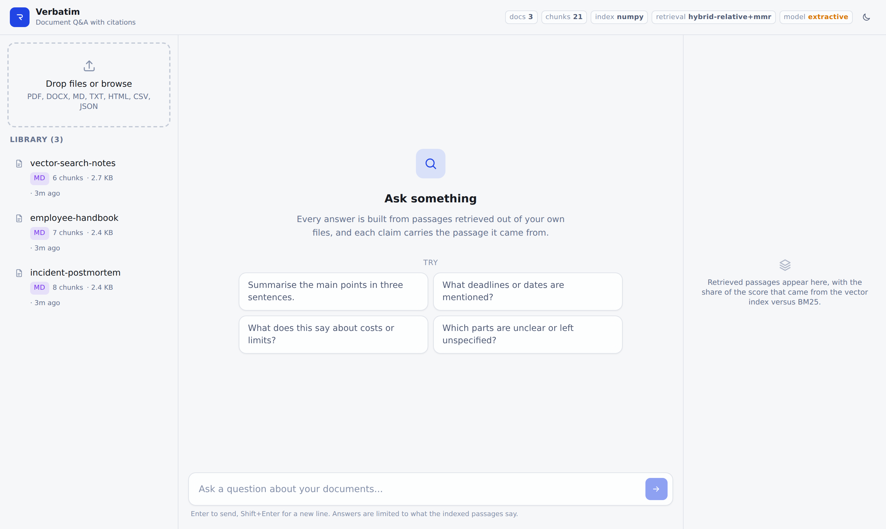
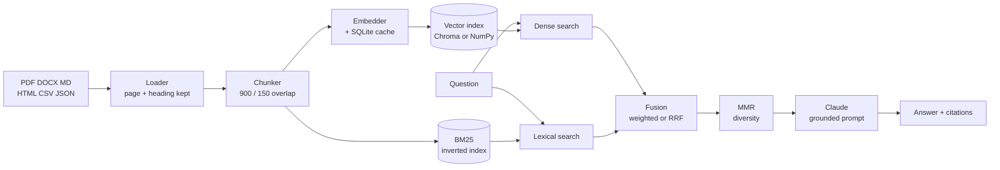

# Verbatim

Ask questions across your own documents and get an answer with the passage
every claim came from.

Verbatim is a retrieval-augmented generation system: documents are chunked,
embedded and indexed; a question retrieves the passages most likely to contain
the answer; Claude writes the answer using only those passages and marks each
sentence with the passage it came from. If the documents do not cover the
question, it says so instead of guessing.



---

## What is actually interesting here

Most RAG demos are a vector store, a top-k lookup and a prompt. That works
until it meets a real corpus, at which point three things break, and the three
of them are what this project is about.

**Dense retrieval alone loses on literal tokens.** Ask about form `EX-114` or
incident `PLAT-2292` and a small encoder has no useful representation for the
string; it returns something semantically adjacent and factually wrong. BM25
runs alongside the vector index and the two rankings are fused. On the sample
corpus this is the difference between finding a reference and confidently
missing it.

**Overlapping chunks make the top 5 the same paragraph five times.** MMR
re-ranks the fused candidates for coverage rather than raw similarity, which is
what makes multi-part questions answerable in one turn.

**An answer without provenance is an assertion.** Citation markers are resolved
back to chunk ids after generation, markers pointing past the end of the
context are dropped rather than rendered, and the UI dims passages that were
retrieved but never cited - so it is visible what the model actually used.

---

## Quickstart

```bash
git clone https://github.com/yuvrajnode/RAG-Based-Document-Q-A-System.git
cd RAG-Based-Document-Q-A-System

make setup                       # venv + dependencies
cp .env.example .env             # then add ANTHROPIC_API_KEY

.venv/bin/verbatim ingest ./samples
.venv/bin/verbatim ask "What is the notice period for a grade 6 employee?"
```

For the web interface, run the API and the client in two terminals:

```bash
make api    # http://localhost:8000  (docs at /api/docs)
make web    # http://localhost:5173
```

Or build the client once and let FastAPI serve it from `/`:

```bash
cd web && npm install && npm run build && cd ..
make api
```

### It runs without any keys

With no `ANTHROPIC_API_KEY`, the system still ingests, indexes and retrieves;
it returns the ranked passages instead of a written answer. With
`VERBATIM_EMBEDDING_PROVIDER=hashing` it also needs no model download - which
is how the test suite runs offline and deterministically in CI. The hashing
embedder retrieves noticeably worse than a trained encoder; it is a
development convenience, not a deployment option.

### Docker

```bash
ANTHROPIC_API_KEY=sk-... docker compose up --build
```

---

## How it works



### Ingestion

Loaders keep the page number and nearest heading on every segment, which is
what lets a citation say *page 7, Expenses* rather than just naming the file.
Chunking walks a separator ladder - paragraph, then line, then sentence, then
word - and only drops a rung when a piece is still over budget, so boundaries
land on sentence ends rather than mid-clause. Documents are content-addressed:
re-uploading the same bytes under a new filename replaces the document instead
of duplicating it.

### Retrieval

Both indexes return `candidate_k` results. Fusion is either weighted min-max
normalised scores (default, `alpha = 0.6` towards dense) or reciprocal rank
fusion, which ignores scores entirely and is more robust when the two
distributions are not comparable - and BM25 scores are unbounded while cosine
similarity is not, so they never really are.

MMR then selects the final `top_k` using the *fused* score as its relevance
term, not raw cosine, so the lexical signal is not silently discarded at the
last step.

### Generation

The prompt permits exactly one thing: answering from the supplied passages,
with a marker on every factual sentence. Refusal is explicitly allowed, because
a model that is not permitted to say "the documents do not cover this" will
invent something instead. Streaming sends the source list before the first
token so the citation panel is painted while the answer is still being written.

---

## Design decisions

| Decision | Why |
| --- | --- |
| Hybrid retrieval by default | Dense misses rare literal tokens, BM25 misses paraphrase. The failure modes are complementary and the fusion costs one index and a few ms. |
| 900-character chunks, 150 overlap | 400 split single policy statements across chunks; 1500 buried the relevant sentence. Overlap matters more than size - without it, a fact straddling a boundary is unretrievable at any k. |
| Two vector backends | Chroma (HNSW) for deployment, an exact flat NumPy index for tests and small corpora. Brute force at 20k chunks is sub-millisecond and removes approximate recall as a variable when debugging retrieval. |
| Embedding cache in SQLite | Re-ingestion and repeated eval runs should not cost another round of API calls. Keyed by (provider, model, text hash), so switching models never returns a stale vector. |
| Citations resolved after generation | A marker the model invented, pointing past the end of the context, is dropped rather than rendered as a real source. |
| No cross-encoder reranker | Roughly +3 points of precision@5 for ~200ms per query. Wrong trade for an interactive UI at this corpus size; revisit past a few hundred thousand chunks. |
| No query rewriting | Multi-turn follow-ups would benefit, but the honest version needs an extra model call before retrieval, and the latency budget is already spent on generation. |
| SSE, not websockets | Traffic is one-directional, it survives proxies that mangle upgrades, and the browser reconnects on its own. |

---

## Evaluation

Retrieval is measured, not asserted. The harness runs a JSONL question set and
reports hit@k, precision@k, recall@k, MRR and nDCG@k, with `--compare`
re-running the same questions under each retrieval configuration.

```bash
.venv/bin/verbatim ingest ./samples
.venv/bin/python -m verbatim.eval.run_eval eval/questions.jsonl --compare
```

```
                          Retrieval evaluation
config          questions   hit@5   precision@5   recall@5   mrr     ndcg@5
dense only      15          0.867   0.173         0.700      0.739   0.771
lexical only    15          0.800   0.160         0.667      0.800   0.800
hybrid          15          0.800   0.160         0.667      0.767   0.775
hybrid + mmr    15          0.867   0.173         0.700      0.780   0.801
```

Those numbers are from the **hashing** embedder on 21 chunks, because that is
what reproduces on any machine with no download - and they are the reason the
harness exists rather than a claim about the ceiling. The hashing embedder is
lexical in nature, so its "dense" column is not a real dense baseline and the
hybrid gap is understated. Point it at `sentence-transformers` and your own
corpus for numbers that mean something about your data.

Relevance is judged by substring rather than chunk id on purpose: chunk ids
move every time `chunk_size` changes, and the whole point of the harness is to
compare configurations. The runner exits non-zero below hit@k 0.66, so CI fails
on a chunking or fusion change that quietly drops recall.

---

## Configuration

Everything is environment-driven; see [`.env.example`](.env.example) for the
full list.

| Variable | Default | Notes |
| --- | --- | --- |
| `ANTHROPIC_API_KEY` | - | Without it, answers are extractive |
| `VERBATIM_LLM_MODEL` | `claude-sonnet-5` | |
| `VERBATIM_EMBEDDING_PROVIDER` | `sentence-transformers` | or `voyage`, `openai`, `hashing` |
| `VERBATIM_EMBEDDING_MODEL` | `BAAI/bge-small-en-v1.5` | query instruction prefix applied automatically for BGE/E5 |
| `VERBATIM_VECTOR_STORE` | `chroma` | or `numpy` |
| `VERBATIM_CHUNK_SIZE` / `_OVERLAP` | `900` / `150` | |
| `VERBATIM_TOP_K` / `_CANDIDATE_K` | `5` / `40` | passages sent to the model / candidates per retriever |
| `VERBATIM_HYBRID_ALPHA` | `0.6` | 1.0 dense only, 0.0 lexical only |
| `VERBATIM_USE_MMR` / `_MMR_LAMBDA` | `true` / `0.65` | |
| `VERBATIM_MAX_UPLOAD_MB` | `25` | enforced while streaming to disk |

Changing the embedding provider or model changes the vector dimension. Delete
the storage directory and re-ingest; the index detects the mismatch and starts
empty rather than returning nonsense.

---

## API

Interactive docs at `/api/docs`.

| Method | Path | Purpose |
| --- | --- | --- |
| `GET` | `/api/health` | Liveness plus index size |
| `GET` | `/api/stats` | Running configuration - provider, backend, strategy |
| `GET` | `/api/documents` | List indexed documents |
| `POST` | `/api/documents` | Upload and index one file |
| `POST` | `/api/documents/batch` | Upload several; partial success is reported per file |
| `DELETE` | `/api/documents/{id}` | Remove a document and its chunks |
| `POST` | `/api/search` | Retrieval only, with per-retriever scores |
| `POST` | `/api/ask` | Answer with citations |
| `POST` | `/api/ask/stream` | The same, as server-sent events |

```bash
curl -s localhost:8000/api/ask \
  -H 'content-type: application/json' \
  -d '{"question": "Which form do I use to claim expenses?"}' | jq '.answer, .citations[0]'
```

`document_ids` on `/ask` and `/search` scopes retrieval to a subset of the
library - the same thing the UI does when you select documents in the sidebar.

---

## Layout

```
verbatim/
  config.py          environment-driven settings
  models.py          Chunk, RetrievedChunk, Citation, Answer
  ingest/            loaders, chunker, ingestion pipeline
  embeddings/        provider interface, four providers, SQLite cache
  store/             Chroma + NumPy backends, document catalogue
  retrieval/         BM25, fusion, MMR, the retriever
  llm/               prompts, Claude client, answer engine
  api/               FastAPI app, routes, schemas
  eval/              metrics and the evaluation runner
  cli.py             ingest / ask / search / list / stats
web/                 React + TypeScript + Tailwind client
tests/               95 tests, no network required
samples/             three documents to try it on
```

## Development

```bash
make test    # 95 tests, ~1s, no network
make lint    # ruff check + format --check
make eval    # retrieval metrics against eval/questions.jsonl
```

The suite runs against the hashing embedder and the flat index, so a clone is
green immediately - no API key, no model download, no fixtures to build.

## Known limits

- Scanned PDFs need OCR before ingestion; the loader raises a clear error
  rather than indexing an empty document.
- The lexical index is rebuilt in full after an ingest. Fine to about 100k
  chunks; past that it wants an incremental posting-list update.
- One process holds one index. Horizontal scaling needs Chroma in server mode
  rather than embedded.
- Follow-up questions carry conversation history into the prompt but not into
  retrieval, so "and for part-time staff?" retrieves on those words alone.


## Contributing

Issues and pull requests are welcome. Run `make test` and `make lint` before
opening a PR so the suite stays green.
