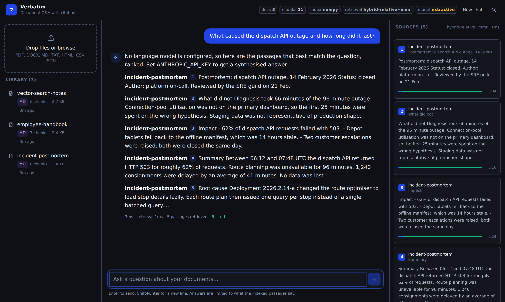

# Architecture

This is the longer version of the "How it works" section in the README, for
anyone who wants to change something rather than run it.

## Object graph

Everything expensive to construct is built once per process in
`RagService` (`verbatim/service.py`): the embedder (which may hold a model in
memory), the vector store, the lexical index and the Claude client. The API,
the CLI and the evaluation harness all take the same object, so there is one
place where configuration turns into behaviour.

```
Settings ──> Embedder ──┬──> VectorStore ──┐
                        │                  ├──> Retriever ──> AnswerEngine
                        └──> BM25Index ────┘         │
                                                     └──> ClaudeClient
DocumentCatalogue ──> IngestionPipeline
```

Writes take a lock and then invalidate the lexical index. The rebuild is lazy,
on the next query, so a bulk upload of forty files pays for one rebuild rather
than forty.

## Ingestion

1. **Load.** `verbatim/ingest/loaders.py` dispatches on extension and returns
   `Segment(text, page, heading)`. Normalisation rejoins words hyphenated
   across line breaks, drops repeated page-number lines, and collapses runs of
   blank lines. A single unreadable PDF page is logged and skipped rather than
   failing the file.

2. **Chunk.** `Chunker` first merges neighbouring segments that share a heading
   and still fit inside the budget - otherwise a PDF with short pages produces
   one tiny chunk per page. It then splits on a separator ladder
   (`\n\n` → `\n` → sentence → word → hard cut) and packs units greedily,
   carrying whole units forward as overlap. Chunks shorter than 80 characters
   are folded into the previous chunk instead of becoming index entries.

3. **Embed.** Texts go through `CachedEmbedder`, which looks up
   `sha256(provider, model, text)` in SQLite and only sends misses to the
   provider. Vectors are L2-normalised, so cosine similarity downstream is a
   dot product.

4. **Index.** Chunks and vectors go to the store; a `DocumentRecord` goes to
   the catalogue. The document id is `sha256` of the extracted text, which is
   what makes re-ingestion idempotent.

## Retrieval

`Retriever.retrieve` runs both indexes at `candidate_k`, fuses, re-ranks and
truncates:

- **Dense.** `store.search(query_vector, candidate_k)` with an optional
  `document_ids` filter pushed down into the backend.
- **Lexical.** `BM25Index.search(query, candidate_k)`. Chunks that only BM25
  found are hydrated with a single batched `store.get(ids)` so they compete on
  equal footing rather than being dropped for lack of text.
- **Fusion.** `relative_score_fusion` (min-max normalise each list, weighted
  sum) or `reciprocal_rank_fusion` (rank-only, `1/(60+rank)`).
- **MMR.** Candidate vectors are re-embedded, which is free after the first
  query because of the cache, and selection uses the fused score as the
  relevance term.
- **Threshold.** Anything below `min_score` is dropped, so a question the
  corpus does not cover produces an empty context and an honest refusal rather
  than five weak passages.

## Generation

`AnswerEngine` builds the prompt (`verbatim/llm/prompts.py`), calls Claude, and
resolves `[n]` markers back to chunk ids. Two behaviours are worth knowing
about:

- **Streaming emits `sources` before the first token.** The UI paints the
  citation panel while the answer is still being written.
- **Failure degrades rather than 500s.** If generation raises, the engine
  returns the ranked passages with a note. The retrieval half of the system is
  still useful when the LLM is not available.

## Storage layout

```
storage/
  chroma/                  Chroma persistent client (when VECTOR_STORE=chroma)
  index/vectors.npy        flat index matrix     (when VECTOR_STORE=numpy)
  index/records.jsonl      ids, text, metadata
  catalogue.sqlite3        one row per document
  embedding-cache.sqlite3  vectors keyed by provider+model+text hash
  uploads/                 transient; each upload is deleted after ingestion
```

The embedding cache is the expensive one to lose. The index can be rebuilt from
the source files; the cache is what stops that rebuild costing another round of
API calls.

## Where the seams are

- `Embedder` - four implementations, add a fifth by subclassing and returning
  a matrix from `_encode`.
- `VectorStore` - `add`, `search`, `get`, `delete_document`, `iter_chunks`,
  `count`, `reset`. A pgvector or Qdrant backend is that interface and nothing
  else.
- Fusion is two pure functions over `dict[chunk_id, score]`, so a third
  strategy does not touch the retriever.


